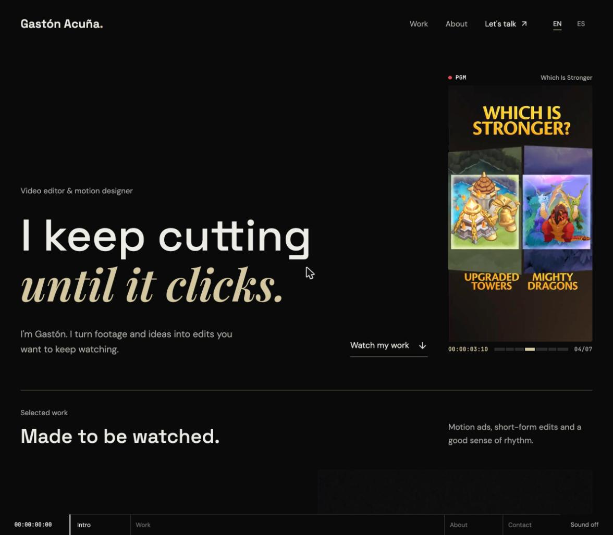

# Gastón Acuña: video portfolio



Live at **[gaston.mov](https://gaston.mov)**. This is my video editing and motion design portfolio. The home page opens with a three-panel video hero, followed by an uneven gallery of work. Each project opens in a video viewer. English and Spanish are available; the site starts with the visitor's saved choice or browser language.

Built with React, Vite, Motion and Tailwind CSS. Videos are hosted on Cloudinary.

## Run locally

Use Node.js 24.

```sh
npm ci
npm run dev
```

```sh
npm run lint
npm test
npm run build
```

Pushing to `main` deploys to GitHub Pages on gaston.mov (`.github/workflows/deploy.yml`, `public/CNAME`).

## Content and architecture

- `src/data/portfolio.js`, `src/data/projectNotes.js` and `src/data/copy.js`: project media, notes and English and Spanish text.
- `src/components/Hero.jsx` and `src/lib/reel.js`: the three-panel hero, made from short Cloudinary video cuts. Mobile shows one panel.
- `src/components/FeaturedWork.jsx` and `src/components/ProjectPoster.jsx`: the uneven work gallery, poster images and short silent previews. The larger pieces play while in view.
- `src/components/ProjectDetail.jsx` and `src/components/media/CloudinaryVideo.jsx`: project details and the video player, with timecode, scrubbing and keyboard controls. The player offers VP9 WebM and MP4 sources.
- `src/hooks/useProjectNavigation.js` and `src/lib/projectRoutes.js`: project selection, browser history and URLs. Opening a gallery project sets `?project=<id>`.
- `src/lib/projectPages.js`: project metadata for `/work/<id>/` share pages generated at build time.
- `src/lib/language.js` and `src/lib/analytics.js`: language selection and GoatCounter page and project event tracking.
- `src/components/TimelineBar.jsx`: section navigation tied to scroll position.

Clients and Playground stay hidden while their data arrays are empty. The site supports reduced motion.
