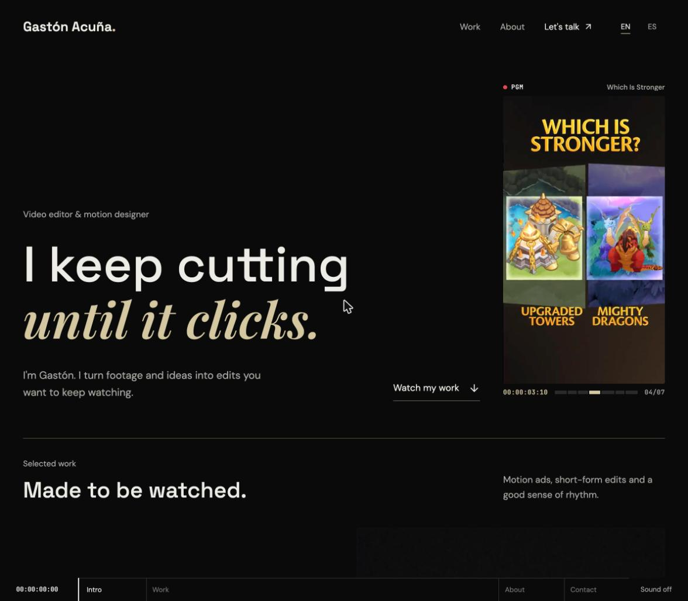

# Gastón Acuña — video portfolio



Live at **[gaston.mov](https://gaston.mov)**. My portfolio for video editing and motion design, built like an editing room: a program monitor in the Hero cutting between real pieces, a viewer with timecode and J/K/L shortcuts, and the page itself read as a timeline. English by default, Spanish live.

Built with React, Vite, Motion and Tailwind CSS. Videos are hosted on Cloudinary.

## Run locally

Use Node.js 24.

```sh
npm ci
npm run dev
```

```sh
npm run lint
npm test
npm run build
```

Pushing to `main` deploys to GitHub Pages on gaston.mov (`.github/workflows/deploy.yml`, `public/CNAME`). `gastonacuna.com` redirects there from the registrar.

## Content and architecture

- `src/data/portfolio.js`: Cloudinary sources, bilingual project data and contact links.
- `src/data/projectNotes.js`: short bilingual project context and approach.
- `src/data/copy.js`: interface, Hero, About and Contact translations.
- `src/lib/reel.js`: the Hero reel, one silent MP4 Cloudinary splices from short cuts of every project.
- `src/components/HeroReel.jsx`: the program monitor around that reel; clicking it opens the piece on screen.
- `src/components/media/CloudinaryVideo.jsx`: the project viewer, with SMPTE timecode, frame counter, scrub and J/K/L, frame-step, mute and fullscreen shortcuts.
- `src/components/ProjectPoster.jsx`: curated poster frames that play a short silent clip on hover.
- `src/components/TimelineBar.jsx`: the page timeline; sections are clips, scroll is the playhead, and it can be dragged to scrub.
- `src/lib/sound.js`: optional interface sound, synthesized with Web Audio and off by default.
- `src/hooks/useProjectNavigation.js` and `useProjectTransition.js`: project URLs, history and the poster flight between gallery and viewer.
- `src/index.css`, `src/edit.css`, `src/components/Contact.css`: styles.

Clients and Playground stay hidden while their data arrays are empty. Add only confirmed public clients and real experiments; no showreel, metrics or client names are fabricated. Reduced motion is respected throughout.
